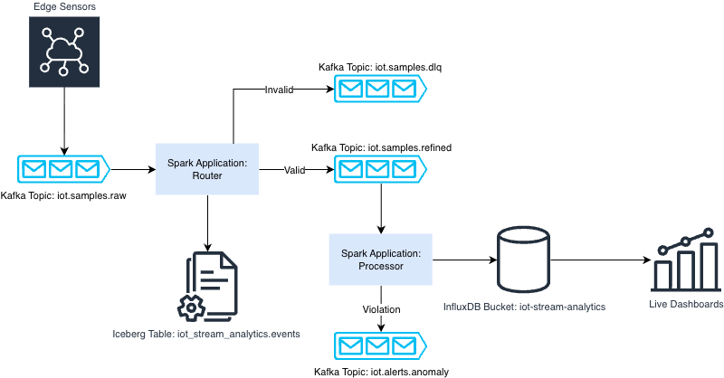

# Real-Time IoT Stream Analytics Pipeline

A production-grade, event-driven streaming data pipeline for processing temperature telemetry data, built with **PySpark 4.1.3 (Scala 2.13)**, Apache Kafka, Apache Iceberg, and InfluxDB. The data flow ingests raw device telemetry, validates payloads against strict schema contracts, routes invalid records to a Dead Letter Queue (DLQ), triggers real-time anomaly alerts, and sinks analytical data into both a time-series database and an open lakehouse table.

## Architecture Overview

The system utilizes a decoupled, event-driven streaming architecture. To ensure fault tolerance, isolation, and horizontal scalability, the data flow is split into two independent PySpark Structured Streaming applications communicating via Apache Kafka brokers:

<div align="center">
  
</div>

### Component Breakdown

#### 1. Data Ingestion & Source
- **Edge Sensors**: Hardware modules stream JSON payloads containing unique device identifiers, operational metrics, and generation timestamps.
- **Raw Ingestion Topic** (`iot.samples.raw`): High-throughput Kafka topic that ingests raw telemetry streams directly from edge device generators.

#### 2. Application 1: Router (`router.py`)
- **Parsing & Cleansing**: Consumes raw streams, parses payloads against a rigid `StructType` contract, and intercepts corrupted text or physically impossible anomalies.
- **Dynamic Conditional Routing**:
  - **Valid Data**: Dispatched to `iot.samples.refined` for downstream operational processing.
  - **Invalid Data (Dead Letter Queue)**: Isolated inside `iot.samples.dlq` so failing payloads can be scrubbed and debugged without crashing cluster lines.
- **Cold Storage Lakehouse**: Simultaneously appends an immutable, daily partitioned audit trail of every data row directly into an Apache Iceberg table format (`iceberg_catalog.bronze.iot_stream_analytics.events`).

#### 3. Application 2: Processor (`processor.py`)
- **Refined Ingestion**: Subscribes to the structurally validated stream on `iot.samples.refined`.
- **Metrics Computation**: Tracks operational telemetry metrics, including network lag and ingestion pipeline latency.
- **Real-Time Alerting**: Evaluates values against strict SLA boundaries (`temperature` > 85.0°C or `power` > 1500W). Breaks immediately publish an alert payload to `iot.alerts.anomaly`.
- **Hot Storage Sink**: Streams micro-batches in parallel across distributed cluster execution slots directly into an InfluxDB timeseries bucket database for dashboard visualization.

## Technical Stack & Dependencies

- **Data Processing Framework**: Apache Spark (PySpark 4.1.3 Core Client)
- **Language & Runtime**: Python 3.12+ / Java OpenJDK 17
- **Compiler Architecture Target**: Scala 2.13 Suffix Mapping
- **Message Broker Suite**: Apache Kafka (Distributed Multi-Topic Orchestration)
- **Open Lakehouse Format**: Apache Iceberg (ACID Transactions, Hadoop Type Catalog)
- **Timeseries Storage**: InfluxDB v2 (Thread-safe synchronous worker partition chunking)

## Repository Structure

The repository follows a clean, production-ready python package structure managed via Poetry:

```text
.
├── README.md
├── images/
│   └── blueprint.png                                # End-to-end multi-app pipeline architecture diagram
├── poetry.lock                                      # Pinlocked project dependency ledger
├── pyproject.toml                                   # PEP 621 metadata, tool definitions, and package path routing
├── src/
│   └── iot_stream_analytics/                        # Core production streaming application logic package
│       ├── __init__.py
│       ├── processor.py                             # Application 2: Metric calculations and InfluxDB sinks
│       └── router.py                                # Application 1: Schema validation, Kafka routing, & Iceberg appends
├── tests/
│   ├── __init__.py
│   └── iot_stream_analytics/                        # Isolated package testing namespace
│       ├── __init__.py
│       ├── conftest.py                              # Shared, session-scoped local SparkSession fixture
│       └── test_pipeline_logic.py                   # Sandboxed test cases for parsing, validation, & alerts
└── utils/                                           # Shared framework components and external execution helper utilities
    ├── generator.py                                 # Continuous, warning-free mock telemetry stream generation engine
    └── spark_helpers.py                             # Centralized, non-redundant logging and SparkSession builders
```

## Getting Started

### 1. Environment Prerequisite Setup
Ensure you have Python 3.12, Java JDK 17, and your standalone cluster environment running. Install dependencies using Poetry:

```bash
# Sync local virtual environment dependencies
poetry install
```

### 2. Environment Variables Matrix
The pipeline code abstracts configurations to environment parameters. Export the following variables or declare them inside a localized `.env` configuration prior to submission:

```bash
export VENV_PYTHON=$(which python)
export KAFKA_SAMPLES_DLQ_TOPIC="iot.samples.dlq"
export KAFKA_SAMPLES_RAW_TOPIC="iot.samples.raw"
export KAFKA_SAMPLES_REFINED_TOPIC="iot.samples.refined"
export KAFKA_ALERTS_ANOMALY_TOPIC="iot.alerts.anomaly"
export KAFKA_BOOTSTRAP_SERVERS="..."
export KAFKA_STARTING_OFFSETS="latest"
export SPARK_CHECKPOINT_LOCATION="..."
export ICEBERG_CATALOG_NAMESPACE="iceberg_catalog.bronze.iot_stream_analytics"
export INFLUX_URL="..."
export INFLUX_TOKEN="..."
export INFLUX_ORG="..."
export INFLUX_BUCKET="iot-stream-analytics"
```

## Running the Pipeline via Spark-Submit

Due to the strict PySpark 4.1.3 / Scala 2.13 runtime requirements, jobs must be routed using matching dependency packages. Submissions are forced into `--deploy-mode client` because Spark Standalone cluster managers do not support cluster mode for native Python drivers.

### 1. Launch the Message Router Pipeline (Application 1)
This step handles core validation, dead letter logging, and mounts files onto your MinIO/S3 object store. It includes explicit Hadoop S3A timeout property overrides to prevent fatal `java.lang.NumberFormatException` crashes on strings like `"60s"` or `"24h"`, and enforces `SimpleAWSCredentialsProvider` to isolate AWS SDK v1/v2 mismatches:

```bash
spark-submit \
  --master spark://127.0.0.1:7077 \
  --deploy-mode client \
  --num-executors 2 \
  --total-executor-cores 2 \
  --executor-memory 2g \
  --class org.apache.spark.deploy.PythonRunner \
  --packages "org.apache.spark:spark-sql-kafka-0-10_2.13:4.1.3,org.apache.iceberg:iceberg-spark-runtime-4.1_2.13:1.12.0,org.apache.iceberg:iceberg-aws-bundle:1.12.0,org.apache.hadoop:hadoop-aws:3.3.4" \
  --conf spark.sql.extensions="org.apache.iceberg.spark.extensions.IcebergSparkSessionExtensions" \
  --conf spark.sql.catalog.iceberg_catalog="org.apache.iceberg.spark.SparkCatalog" \
  --conf spark.sql.catalog.iceberg_catalog.type="hadoop" \
  --conf spark.sql.catalog.iceberg_catalog.warehouse="s3a://iceberg-warehouse/iceberg_catalog" \
  --conf spark.sql.catalog.iceberg_catalog.s3.path-style-access="true" \
  --conf spark.hadoop.fs.s3a.access.key="..." \
  --conf spark.hadoop.fs.s3a.secret.key="..." \
  --conf spark.hadoop.fs.s3a.endpoint="..." \
  --conf spark.hadoop.fs.s3a.path.style.access="true" \
  --conf spark.hadoop.fs.s3a.connection.ssl.enabled="false" \
  --conf spark.hadoop.fs.s3a.impl="org.apache.hadoop.fs.s3a.S3AFileSystem" \
  --conf spark.hadoop.fs.s3a.aws.credentials.provider="org.apache.hadoop.fs.s3a.SimpleAWSCredentialsProvider" \
  --conf spark.hadoop.fs.s3a.connection.timeout=60000 \
  --conf spark.hadoop.fs.s3a.connection.establish.timeout=60000 \
  --conf spark.hadoop.fs.s3a.threads.keepalivetime=60 \
  --conf spark.hadoop.fs.s3a.connection.ttl=86400000 \
  --conf spark.hadoop.fs.s3a.multipart.purge.age=86400 \
  --conf spark.streaming.stopGracefullyOnShutdown="true" \
  --conf spark.sql.shuffle.partitions=4 \
  --conf spark.pyspark.driver.python="$VENV_PYTHON" \
  --conf spark.pyspark.python="$VENV_PYTHON" \
  --conf spark.executorEnv.PYSPARK_PYTHON="$VENV_PYTHON" \
  src/iot_stream_analytics/router.py
```

### 2. Launch the Analytics Telemetry Processor (Application 2)
This script processes the cleansed stream, aggregates metrics, monitors latency intervals, and feeds InfluxDB. It tunes partition shuffle layers to `4` to prevent task scheduling overhead on your 2-core standalone layout:

```bash
spark-submit \
  --master spark://127.0.0.1:7077 \
  --deploy-mode client \
  --num-executors 2 \
  --total-executor-cores 2 \
  --executor-memory 2g \
  --class org.apache.spark.deploy.PythonRunner \
  --packages "org.apache.spark:spark-sql-kafka-0-10_2.13:4.1.3" \
  --conf spark.sql.shuffle.partitions=4 \
  --conf spark.streaming.stopGracefullyOnShutdown="true" \
  --conf spark.pyspark.driver.python="$VENV_PYTHON" \
  --conf spark.pyspark.python="$VENV_PYTHON" \
  --conf spark.executorEnv.PYSPARK_PYTHON="$VENV_PYTHON" \
  src/iot_stream_analytics/processor.py
```


## Data Contracts

### Expected Input Format (SAMPLE_SCHEMA)
Inbound events must match the following JSON contract layout:

```json
{
  "device_id": "DEV-9982",
  "sensor_id": "TEMP-04",
  "event_timestamp": "2026-10-06T12:00:00.000Z",
  "temperature": 23.4,
  "power": 1200.5
}
```

## Validation & Routing Rules
- **Valid**: Payload structurally conforms to the JSON layout and device `power` is a positive value.
- **Invalid (DLQ Bound)**: Payload contains JSON corruption, structural syntax malformations, missing required fields, or physically impossible anomalies (such as negative power draw).

*Note: Sub-zero temperature readings are treated as valid data to support outdoor environmental sensors. Furthermore, payloads containing critical threshold breaches (e.g., temperature > 85.0°C or power > 1500W) are explicitly handled as structurally valid and passed downstream so they can successfully trigger real-time alerts in the Processor application.*

## Core Optimization & Resilience Patterns

- **Partition Shuffle Tuning**: Global default shuffle partitions are optimized from `200` down to `4` (a balanced 2× multiple of the standalone cluster's 2-core execution capacity). This prevents data fragmentation and avoids hundreds of slow scheduling waves.
- **Lineage Caching & Persistence**: Leverages `.persist(StorageLevel.MEMORY_AND_DISK)` on multi-branch evaluation tracks, ensuring that raw JSON string decodes and latency calculations are calculated exactly once in memory.
- **Backpressure Constraints**: Implements strict traffic limits (`maxOffsetsPerTrigger=20000`) to guarantee cluster data ingestion remain fully stable during upstream broker volume spikes.
- **Graceful Shutdown**: Enforces `stopGracefullyOnShutdown=true` parameters to guarantee zero message drop-offs or uncommitted offset boundaries when dropping streaming threads during cluster maintenance.
- **Distributed InfluxDB Writes**: Instead of collecting data to the driver, writes are executed in parallel across Spark worker partitions (`rdd.foreachPartition`) utilizing specialized connection chunking features.

## Real-Time Data Streaming & Simulation

### Continuous Stream Data Seeding (utils/generator.py)

To monitor the entire end-to-end streaming data flow visually, you can execute the plain Python stream generator utility. It feeds realistic, continuous multi-scenario streams into your broker setup and shows the outputs in the terminal:

```bash
poetry run python utils/generator.py
```

This generator continuously publishes four data patterns to allow you to test your pipeline branches in real time:
1. **Standard Operations**: Clean telemetry rows that flow directly down to the Hot and Cold storage sinks.
2. **Payload Corruption**: Intentionally broken JSON structures to verify the Router's syntax isolation path.
3. **Invalid Metrics**: Out-of-bounds metrics (e.g., sub-zero equipment parameters) to verify the Router's validation checks.
4. **Metric Surges**: High temperature or wattage levels to verify the Processor's anomaly detection alarms.

### Automated In-Memory Testing Suite

The repository includes a decoupled pytest framework structured to evaluate your Functional Core data transformations and path splitting rules completely in-memory, avoiding any live network data leaks or external cluster dependencies:

```bash
# Clear out out-of-date testing cache targets
rm -rf .pytest_cache/

# Execute the unit testing suite context
poetry run python -m pytest tests/ -v
```